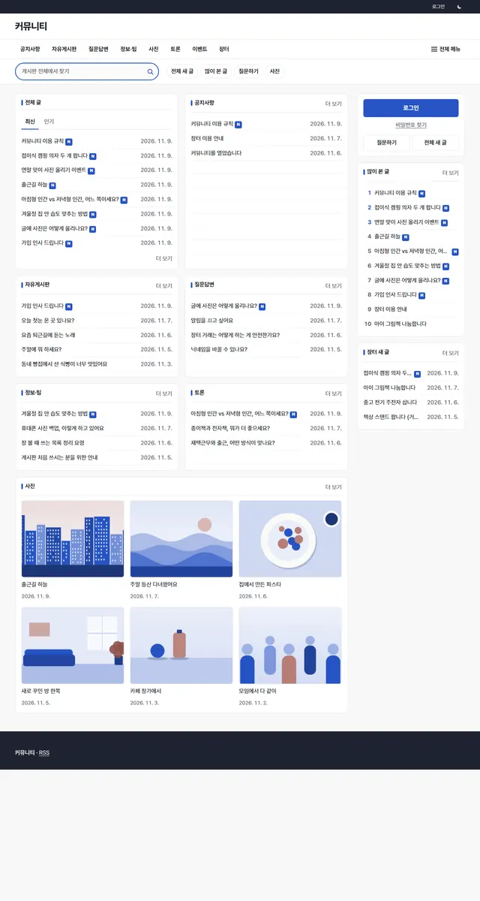
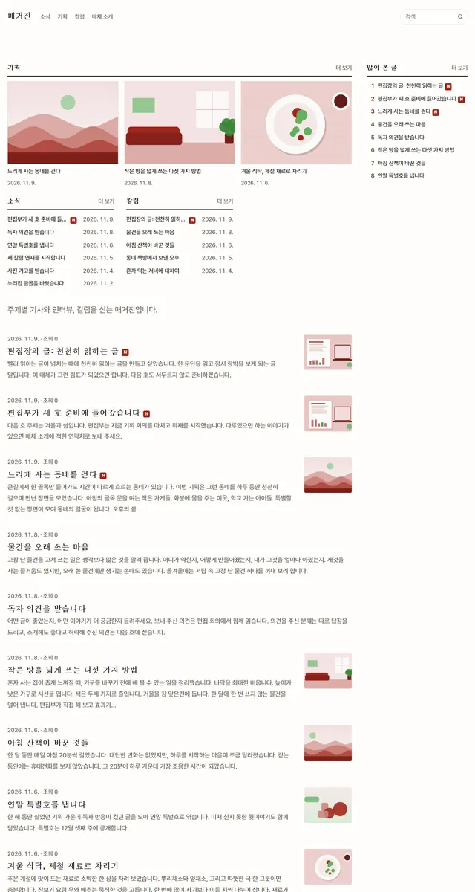
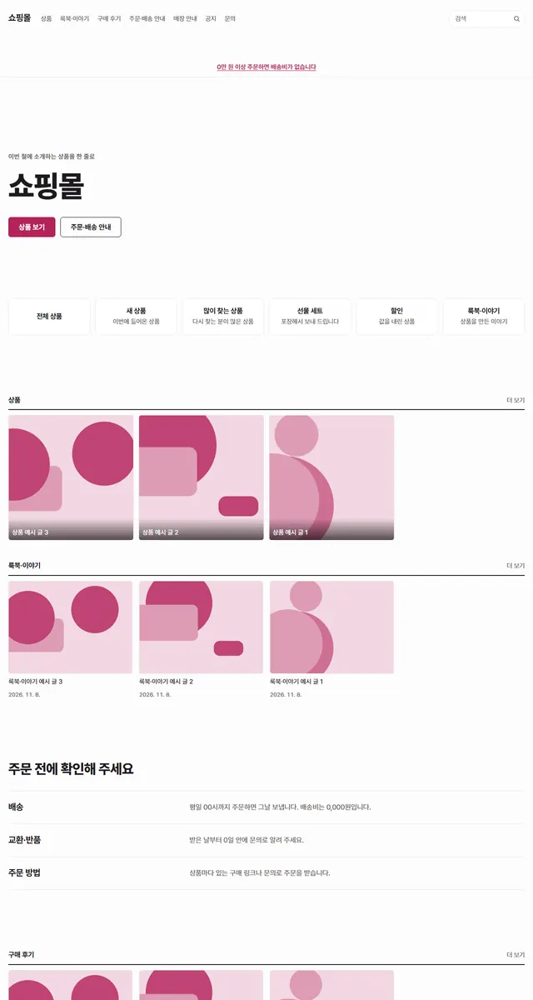
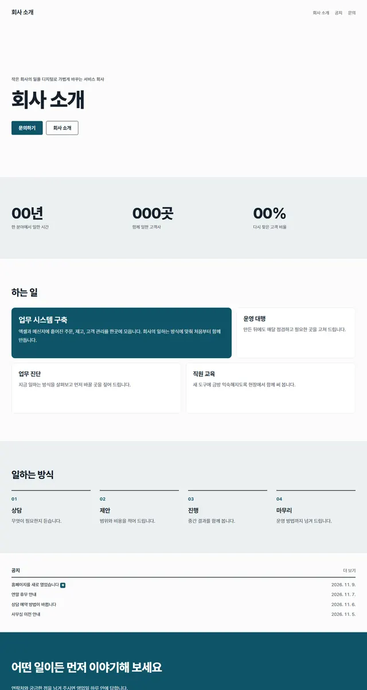
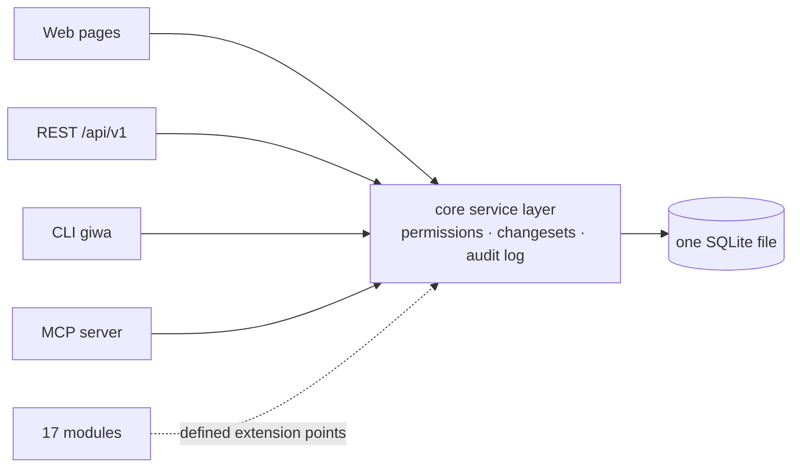

<p align="center">
  
</p>

<h1 align="center">Giwa · 기와</h1>

<p align="center">
  <b>Tell your agent one sentence. Get a Korean-style website on your own computer in minutes.</b><br>
  Boards, communities, blogs, shops and bookings. One binary and one SQLite file.
</p>

<p align="center">
  <a href="https://github.com/Evanciel/giwa/actions/workflows/ci.yml"></a>
  
  
  
  <a href="#license"></a>
</p>

<p align="center">
  <a href="README.md">한국어</a> · <b>English</b>
</p>

<p align="center">
  
  
  
  
</p>

> [!NOTE]
> Giwa is at **0.1, early stage**. Prebuilt releases are on the way; for now, [install from source](#quick-start).

---

## What it feels like

You don't click through an admin panel. You talk to your agent (Claude Code, Claude Desktop, Cursor).

```text
You    › Make a neighborhood community site. Notices, a free board, and a photo board.

Agent  › giwa init --preset community --name "Our Block" --yes
         giwa serve
         Your site is up: http://127.0.0.1:8080

You    › Make the main color warmer and show new marketplace posts on the home page.

Agent  › I staged a changeset. Preview it here: http://127.0.0.1:8080/__preview/…
         Say "apply" if it looks good. If not, it can be reverted in one step.
```

Every change to structure or design goes into a **changeset**. The agent hands you a preview link, and nothing reaches the live site until a human approves it.

## Why Giwa

|  | The usual way | Giwa |
|---|---|---|
| **Install** | Web server, PHP and a database server | One file. No database server, Redis or Node |
| **Permissions** | Admin rights, firewall rules | Runs from your user folder, no admin rights |
| **Management** | A person clicks through an admin panel | Ask your agent. Web, REST, CLI and MCP share one service layer |
| **Changes** | Live the moment you hit save | Preview → approve → apply, one-step revert |
| **Going public** | Port forwarding, a hosting plan | `giwa expose` opens a tunnel. Binds to `127.0.0.1` by default |
| **Data** | Databases and files in many places | One folder. Copy it and you have a backup |

## Highlights

**🤖 Agents are first-class users**
- Built-in MCP server (`giwa mcp install --client claude-code|claude-desktop|cursor`)
- Every CLI command speaks `--json`, runs without prompts, and is safe to run twice
- Errors explain the cause and include **the next command to run**
- Posts and comments reach the agent as data, never as instructions

**🇰🇷 What Korean sites expect**
- Notice, free, Q&A and photo boards with secret posts, categories, votes, popular posts and reports
- Kakao, Naver and Google sign-in, KakaoTalk link previews, Kakao and Naver maps
- Payments: bank transfer, Toss Payments, PortOne V2, plus the seller-info footer and terms/refund pages Korean law expects
- Naver Search Advisor and Google Search Console verification, automatic sitemap, RSS and IndexNow
- Korean typography defaults (line height, word-level line breaking)

**🎨 23 presets to start from**
- Community, blog, company, shop, café or small store, clinic, academy, fitness studio, guesthouse, real estate, church, club, magazine, portfolio, jobs, courses, events, docs/wiki and more
- Style with design tokens (color, type, spacing) and section blocks, and save the blocks you reuse

**🧩 17 modules, on when you need them**
- Payments `pay` · Shop `shop` · Booking `booking` · Consultation `consult` · Forms `forms` · Polls `poll`
- Points `point` · Reactions `reaction` · Scrap `scrap` · Reports `report` · Messages `message` · Notifications `notify`
- Social login `social` · Kakao `kakao` · Maps `map` · Ads `ads` · Webhooks `webhook`

**🔒 Safe defaults**
- Passwords hashed with argon2id; tokens, sessions and login links stored only as hashes
- Every write lands in an audit log; backup and restore are one command each
- Installable as a home-screen app (PWA), media library, video uploads, English-language sites

## Quick start

**1. Install** · Requires [Rust](https://rustup.rs) 1.99 or newer.

```bash
cargo install --locked --git https://github.com/Evanciel/giwa giwa-cli
```

**2. Create a site**

```bash
giwa init --data ./my-site --preset community --name "Our Block" --yes
giwa serve --data ./my-site
```

Open `http://127.0.0.1:8080`. Get a one-time login link for the admin panel with `giwa login-link --data ./my-site`.

**3. Connect your agent**

```bash
giwa mcp install --data ./my-site --client claude-code --scope read --scope draft --scope publish --scope structure --scope design
```

Restart your agent and try "add another free board".

> [!TIP]
> You can hand the whole thing to your agent from the start:
> "Read AGENTS.md at https://github.com/Evanciel/giwa and build me a blog on this computer."

## Presets

| What you're building | Presets |
|---|---|
| Writing and gathering | `community` · `blog` · `club` · `magazine` |
| Stores and businesses | `company` · `shop` · `cafe` (café, restaurant, workshop) · `landing` (one-pager) |
| Places that take bookings | `clinic` · `academy` · `studio` (fitness) · `stay` (guesthouse) |
| Professional offices | `office` (law, tax) · `realty` · `platform` (marketplace) |
| Organizations | `org` · `church` (religious groups) · `event` (sign-ups) |
| Everything else | `portfolio` · `linkbio` · `jobs` · `course` · `docs` (docs/wiki) |

## Architecture



All four entry points call the same service layer, so permissions and results are identical whichever way you come in.

## Docs

| Document | What's inside |
|---|---|
| [AGENTS.md](AGENTS.md) | Install and operations playbook for agents |
| [llms.txt](llms.txt) | Summary index for agents |
| [docs/SPEC.md](docs/SPEC.md) | Full design (permissions, changesets, CLI, MCP) |
| [docs/DECISIONS.md](docs/DECISIONS.md) | 173 architecture decision records |

The docs above are written in Korean; agents read them fine either way.

## Development

```bash
cargo build
cargo test --workspace
```

The 72 end-to-end tests in `crates/cli/tests/e2e_*.rs` start the real binary on a real port against a real database file. The pre-commit gate is `scripts/check.ps1` (fmt · clippy · dependency direction · tests · sqlx metadata).

## Where it stands

Being upfront about it:

- Only one site runs on Giwa in production so far. Real-world feedback and issues are very welcome.
- There has been no external security audit. Use test mode before turning on live payments.
- `giwa update` verifies checksums but does not verify signatures yet.

## License

Your choice of [MIT](LICENSE-MIT) or [Apache-2.0](LICENSE-APACHE). Third-party material is credited in [THIRD_PARTY.md](THIRD_PARTY.md).
