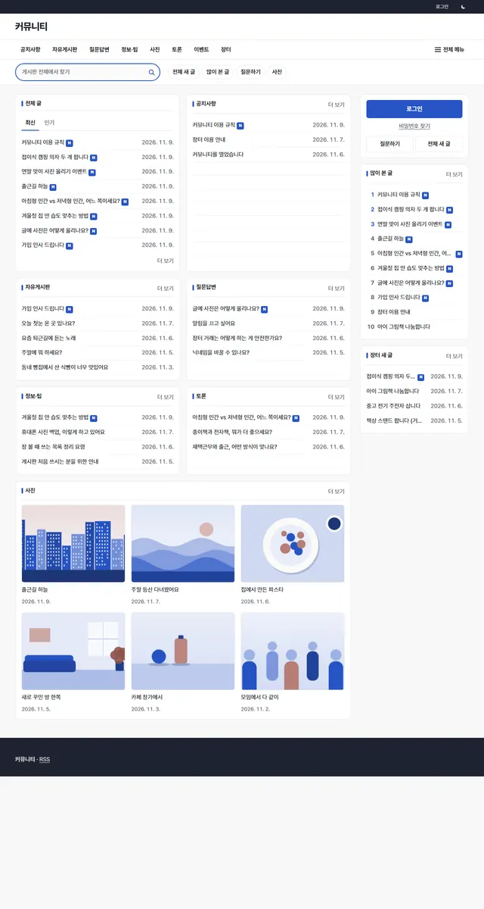
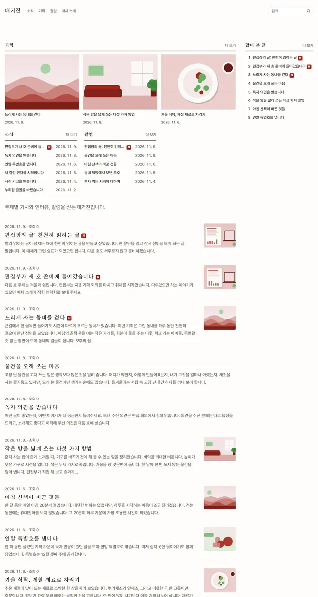
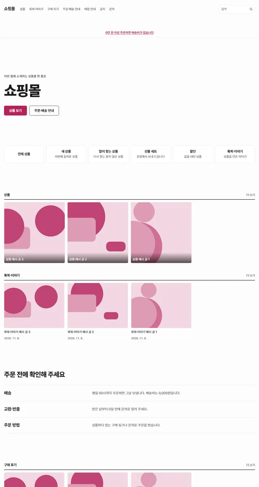
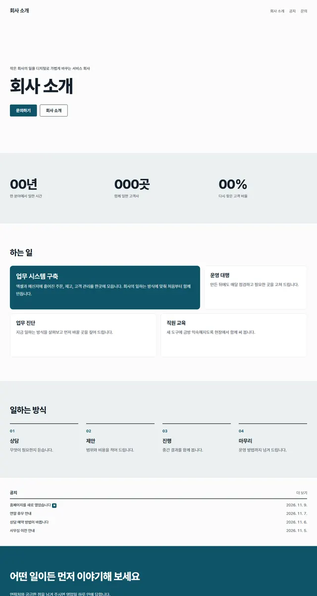
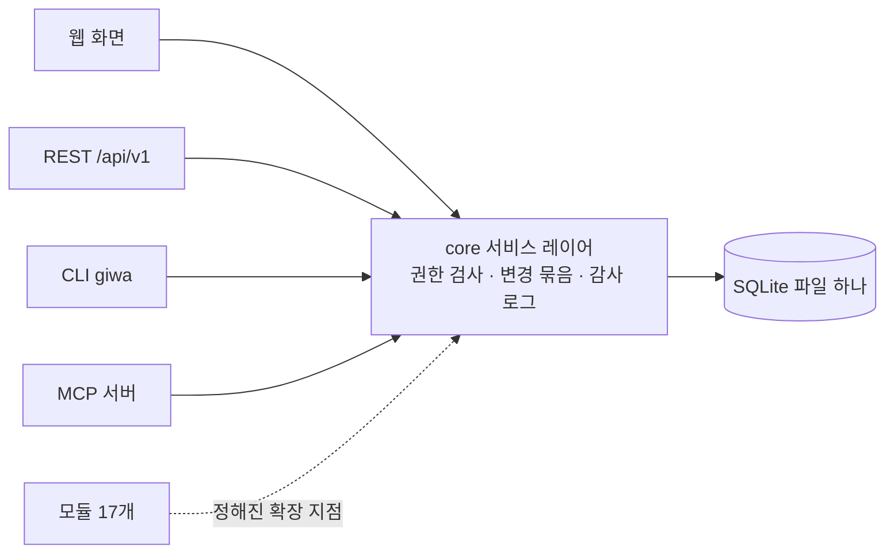

<p align="center">
  
</p>

<h1 align="center">Giwa · 기와</h1>

<p align="center">
  <b>에이전트에게 한마디 하면, 내 컴퓨터에 한국형 홈페이지가 몇 분 만에.</b><br>
  게시판 · 커뮤니티 · 블로그 · 쇼핑몰 · 예약까지. 바이너리 하나와 SQLite 파일 하나로 돕니다.
</p>

<p align="center">
  <a href="https://github.com/Evanciel/giwa/actions/workflows/ci.yml"></a>
  
  
  
  <a href="#라이선스"></a>
</p>

<p align="center">
  <b>한국어</b> · <a href="README.en.md">English</a>
</p>

<p align="center">
  
  
  
  
</p>

> [!NOTE]
> 지금은 **0.1, 초기 단계**입니다. 미리 빌드한 릴리스는 준비 중이라 당분간은 [소스에서 설치](#빠른-시작)합니다.

---

## 이렇게 씁니다

관리 화면을 하나하나 클릭하지 않습니다. 에이전트(Claude Code, Claude Desktop, Cursor)에게 말하면 됩니다.

```text
나       › 동네 커뮤니티 사이트 만들어 줘. 공지랑 자유게시판, 사진 게시판도 있으면 좋겠어.

에이전트 › giwa init --preset community --name "우리 동네" --yes
           giwa serve
           사이트를 열었습니다: http://127.0.0.1:8080

나       › 메인 색을 좀 더 따뜻하게 하고, 첫 화면에 장터 새 글도 보여 줘.

에이전트 › 변경 묶음을 만들었습니다. 바뀐 화면을 미리 보세요: http://127.0.0.1:8080/__preview/…
           괜찮으면 「적용」이라고 말씀해 주세요. 마음에 안 들면 한 번에 되돌릴 수 있습니다.
```

구조나 디자인을 바꾸는 일은 모두 **변경 묶음(changeset)** 에 담깁니다. 에이전트는 미리보기 주소를 건네고, 사람이 승인해야 실제 사이트에 반영됩니다.

## 왜 기와인가

|  | 흔한 방식 | 기와 |
|---|---|---|
| **설치** | 웹 서버, PHP, DB 서버를 따로 설치 | 파일 하나. DB 서버·Redis·Node 필요 없음 |
| **권한** | 관리자 권한, 방화벽 설정 | 관리자 권한 없이 사용자 폴더에서 실행 |
| **관리** | 관리 화면에서 사람이 직접 클릭 | 에이전트에게 말로. 웹·REST·CLI·MCP가 같은 기능을 씀 |
| **변경** | 저장하는 순간 바로 반영 | 미리보기 → 승인 → 적용, 한 번에 되돌리기 |
| **외부 공개** | 포트 포워딩, 호스팅 계약 | `giwa expose` 로 터널 연결. 기본은 `127.0.0.1` 에만 열림 |
| **데이터** | 여러 곳에 흩어진 DB와 파일 | 폴더 하나. 통째로 복사하면 백업 |

## 주요 기능

**🤖 에이전트가 1급 사용자**
- MCP 서버 내장 (`giwa mcp install --client claude-code|claude-desktop|cursor`)
- 모든 CLI 명령이 `--json` 을 지원하고, 묻지 않고 끝까지 돌며, 여러 번 실행해도 안전합니다
- 실패하면 원인과 함께 **다음에 실행할 명령**을 알려 줍니다
- 글·댓글 같은 사용자 입력은 에이전트에게 지시가 아닌 데이터로만 전달됩니다

**🇰🇷 한국 사이트에 필요한 것들**
- 공지·자유·질문·사진 게시판, 비밀글, 말머리, 추천, 인기 글, 신고
- 카카오·네이버·구글 로그인, 카카오톡 공유 미리보기, 카카오·네이버 지도
- 결제: 무통장 입금, 토스페이먼츠, PortOne V2. 사업자 정보 푸터, 약관·환불 규정 페이지
- 네이버 서치어드바이저·구글 서치 콘솔 확인, 사이트맵·RSS·IndexNow 자동
- 한글 타이포그래피 기본값 (줄 간격, 단어 단위 줄바꿈)

**🎨 23가지 프리셋으로 바로 시작**
- 커뮤니티, 블로그, 회사, 쇼핑몰, 카페·가게, 병원, 학원, 운동 스튜디오, 펜션, 부동산, 교회, 동호회, 매거진, 포트폴리오, 채용, 강의, 행사, 문서·위키 등
- 디자인 토큰(색·글꼴·간격)과 섹션 블록으로 꾸미고, 자주 쓰는 블록은 저장해 다시 씁니다

**🧩 필요한 것만 켜는 모듈 17개**
- 결제 `pay` · 쇼핑 `shop` · 예약 `booking` · 상담 `consult` · 신청서 `forms` · 투표 `poll`
- 포인트 `point` · 반응 `reaction` · 스크랩 `scrap` · 신고 `report` · 쪽지 `message` · 알림 `notify`
- 소셜 로그인 `social` · 카카오 `kakao` · 지도 `map` · 광고 `ads` · 웹훅 `webhook`

**🔒 안전한 기본값**
- 비밀번호는 argon2id, 토큰·세션·로그인 링크는 해시만 저장
- 모든 쓰기 작업을 감사 로그에 남기고, 백업·복원은 명령 하나
- 홈 화면 설치(PWA), 미디어 보관함, 영상 업로드, 영어 사이트 지원

## 빠른 시작

**1. 설치** · [Rust](https://rustup.rs) 1.99 이상이 필요합니다.

```bash
cargo install --locked --git https://github.com/Evanciel/giwa giwa-cli
```

**2. 사이트 만들기**

```bash
giwa init --data ./my-site --preset community --name "우리 동네" --yes
giwa serve --data ./my-site
```

브라우저에서 `http://127.0.0.1:8080` 을 엽니다. 관리 화면에 들어갈 일회용 로그인 링크는 `giwa login-link --data ./my-site` 로 받습니다.

**3. 에이전트 연결**

```bash
giwa mcp install --data ./my-site --client claude-code --scope read --scope draft --scope publish --scope structure --scope design
```

에이전트를 다시 시작하고 「자유게시판 하나 더 만들어 줘」라고 말해 보세요.

> [!TIP]
> 처음부터 에이전트에게 맡겨도 됩니다.
> 「https://github.com/Evanciel/giwa 의 AGENTS.md 를 읽고 내 컴퓨터에 블로그를 만들어 줘」

## 프리셋

| 무엇을 만들까 | 프리셋 |
|---|---|
| 글 쓰고 모이기 | `community` 커뮤니티 · `blog` 블로그 · `club` 동호회 · `magazine` 매거진 |
| 가게·사업 | `company` 회사 · `shop` 쇼핑몰 · `cafe` 카페·식당·공방 · `landing` 한 장짜리 소개 |
| 예약 받는 곳 | `clinic` 병원 · `academy` 학원 · `studio` 운동 스튜디오 · `stay` 펜션·민박 |
| 전문 사무소 | `office` 법률·세무 · `realty` 부동산 · `platform` 중개 플랫폼 |
| 단체 | `org` 기관·협회 · `church` 종교 단체 · `event` 행사 신청 |
| 그 밖에 | `portfolio` 포트폴리오 · `linkbio` 링크 모음 · `jobs` 채용 · `course` 강의 · `docs` 문서·위키 |

## 구조



네 가지 입구가 모두 같은 서비스 레이어를 부릅니다. 어느 입구로 들어와도 권한과 결과가 같습니다.

## 문서

| 문서 | 내용 |
|---|---|
| [AGENTS.md](AGENTS.md) | 에이전트가 따라 하는 설치·운영 절차 |
| [llms.txt](llms.txt) | 에이전트용 요약 색인 |
| [docs/SPEC.md](docs/SPEC.md) | 전체 설계 (권한, 변경 묶음, CLI, MCP) |
| [docs/DECISIONS.md](docs/DECISIONS.md) | 설계 결정 기록 175개 |

## 개발

```bash
cargo build
cargo test --workspace
```

`crates/cli/tests/e2e_*.rs` 의 e2e 테스트 72개는 실제 바이너리를 실제 포트에 띄우고 실제 DB 파일로 확인합니다. 커밋 전 게이트는 `scripts/check.ps1` (fmt · clippy · 의존 방향 · 테스트 · sqlx 메타데이터) 입니다.

## 지금 상태

솔직하게 적어 둡니다.

- 운영 중인 사이트는 아직 한 곳뿐입니다. 실제 사용 후기와 이슈를 환영합니다.
- 외부 보안 점검은 받지 않았습니다. 결제를 실제로 켜기 전에 꼭 시험 모드로 확인하세요.
- `giwa update` 는 체크섬만 확인하고 서명 검증은 아직 없습니다.

## 라이선스

[MIT](LICENSE-MIT) 또는 [Apache-2.0](LICENSE-APACHE) 중 원하는 쪽을 고르세요. 함께 쓰는 외부 자료의 출처는 [THIRD_PARTY.md](THIRD_PARTY.md) 에 있습니다.
